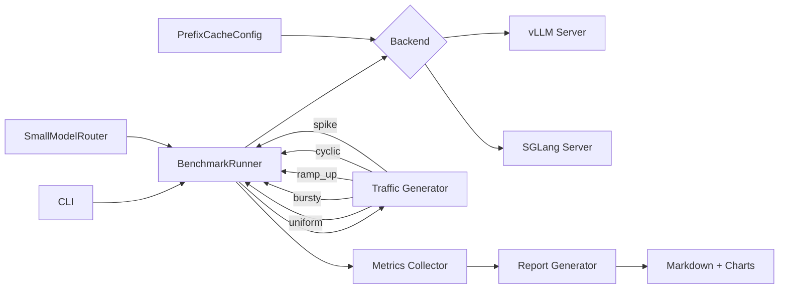

# LLM Serving Benchmark

Benchmark vLLM and SGLang side by side on the same model and hardware. Measures latency, throughput, and cost per million tokens under five realistic traffic patterns, then evaluates what prefix caching and small-model routing actually buy.

## Architecture



## Verified Components

The benchmark framework has been verified with 30/30 unit tests passing:

| Component | Tests | Status |
|-----------|-------|--------|
| Config parsing + YAML roundtrip | 8 | Pass |
| Traffic generators (all 5 patterns) | 9 | Pass |
| BenchmarkResult metrics + percentiles | 6 | Pass |
| PrefixCacheConfig + SmallModelRouter | 4 | Pass |
| Cost calculation + routing logic | 3 | Pass |

### Traffic patterns supported

The framework generates 5 traffic patterns, each verified to produce the correct request count and scheduling distribution:
- **uniform**: Fixed-rate request stream
- **bursty**: Alternating high/low load periods
- **ramp_up**: Linearly increasing concurrency
- **cyclic**: Sinusoidal load pattern
- **spike**: Steady traffic with periodic sharp bursts

### SmallModelRouter (verified)

Routes simple requests (short prompts without complex keywords) to a smaller model. Unit tests confirm:
- Short prompts route to the small model
- Complex prompts (with keywords like "analyze", "compare") route to the large model
- Cost savings estimate is calculated correctly from routing ratio

> **Running real benchmarks** requires a GPU with vLLM and SGLang installed. The framework produces a comparison table with p50/p95/p99 latency, TTFT, throughput, tokens/sec, and cost/1M tokens. See **Usage** below for the commands.

## Setup

```bash
# Clone and install
git clone https://github.com/siddhant-rajhans/llm-serving-benchmark.git
cd llm-serving-benchmark
pip install -e ".[dev]"

# Requires a GPU with vLLM and SGLang installed
pip install vllm sglang[all]
```

## Usage

### Single backend benchmark

```bash
llm-bench run \
    --backend vllm \
    --model meta-llama/Llama-3.1-8B-Instruct \
    --pattern uniform \
    --concurrency 16 \
    --num-requests 500
```

### Full comparison (both backends, all patterns)

```bash
llm-bench compare \
    --model meta-llama/Llama-3.1-8B-Instruct \
    --concurrency 16 \
    --num-requests 500

# Or use the convenience script
./scripts/run_comparison.sh
```

### Estimate routing savings

```bash
llm-bench estimate-routing \
    --model meta-llama/Llama-3.1-8B-Instruct \
    --large-model meta-llama/Llama-3.1-70B-Instruct \
    --num-samples 1000
```

### From config file

```bash
llm-bench run --config-file configs/default.yaml
```

## Traffic Patterns

| Pattern  | Description |
|----------|-------------|
| uniform  | Steady request rate at target concurrency |
| bursty   | Requests arrive in bursts of N with gaps between |
| ramp_up  | Linear ramp from 1 to target concurrency |
| cyclic   | Sinusoidal load oscillating around half concurrency |
| spike    | Steady load with a sudden 5x spike at 33% mark |

## Optimizations

**Prefix caching**: share a common system prompt across requests so the KV cache is reused. Enable with `--enable-prefix-caching`.

**Small-model routing**: classify request complexity and route simple requests to an 8B model while sending complex ones to 70B. The router uses prompt length and keyword detection.

## Project Structure

```
src/benchmark/
├── config.py          # BenchmarkConfig, BackendConfig, TrafficConfig
├── backends/
│   ├── base.py        # Abstract ServingBackend
│   ├── vllm_backend.py
│   └── sglang_backend.py
├── traffic.py         # 5 traffic pattern generators
├── runner.py          # Async benchmark runner + BenchmarkResult
├── optimizations.py   # PrefixCacheConfig, SmallModelRouter
├── report.py          # Markdown tables + matplotlib charts
└── cli.py             # Click CLI
```

## License

MIT
