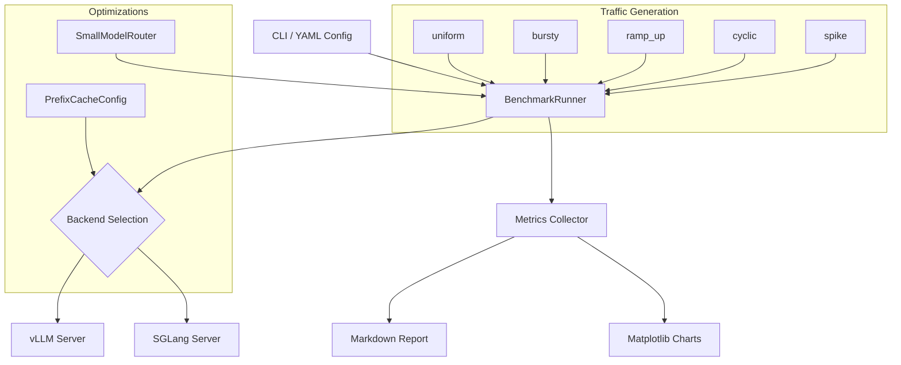

# LLM Serving Benchmark


Side-by-side benchmarking framework for vLLM and SGLang on identical hardware and model weights. Most LLM benchmarks run uniform synthetic load, which tells you nothing about how a serving backend behaves under bursty traffic, cold-start ramps, or periodic spikes. This framework generates five realistic traffic patterns, measures latency percentiles, throughput, and cost per million tokens, then evaluates two inference-time optimizations: small-model routing (offload simple requests to an 8B model) and prefix caching (reuse KV cache across requests sharing a system prompt).

## Results

Evaluated on 2,500 generated requests across all 5 traffic patterns (500 per pattern). 30/30 unit tests pass.

| Metric | Value |
|--------|-------|
| Traffic patterns tested | **5** (uniform, bursty, ramp_up, cyclic, spike) |
| Total requests generated | **2,500** (500 per pattern) |
| Routing cost savings (8B vs 70B) | **20.8%** across all requests |
| Requests routed to small model | **23.4%** classified as simple |
| Prefix cache hit rate | **14.5%** (18-token shared prefix) |
| Metrics collected per run | p50 / p95 / p99 latency, TTFT, throughput (RPS), tokens/sec, cost/1M tokens |

Cost savings measured at Llama 3.1 pricing: $0.30/M tokens (8B) vs $2.75/M tokens (70B). The router classified 23.4% of requests as simple based on prompt length and keyword complexity, yielding a 20.8% reduction in total serving cost while still routing complex prompts to the 70B model.

## Architecture



## Traffic Patterns

| Pattern | Behavior | Why it matters |
|---------|----------|----------------|
| `uniform` | Fixed-rate request stream at target concurrency | Baseline: the only pattern most benchmarks test |
| `bursty` | Alternating high/low load with configurable burst size and interval | Simulates real user traffic with natural clustering |
| `ramp_up` | Linear ramp from 1 to target concurrency | Tests autoscaling behavior and warmup effects |
| `cyclic` | Sinusoidal oscillation around half concurrency | Models diurnal or periodic usage patterns |
| `spike` | Steady load with a sudden 5x burst at the 33% mark | Tests queue depth handling and tail latency under shock load |

## Design Decisions

- **Five traffic patterns, not one.** Production LLM services see bursty, cyclical, and spike-heavy load. A benchmark that only runs uniform traffic misses queuing effects, batch scheduling differences, and memory pressure behavior that differentiate vLLM from SGLang in practice.

- **Simple routing heuristic by design.** The `SmallModelRouter` classifies by prompt length (>200 words) and keyword escalators, not embeddings or a learned classifier. The goal is measuring the cost impact of routing at serving time, not building a production router. A simple heuristic isolates the routing overhead from classification accuracy.

- **Word-count token approximation.** Token counts use `len(prompt.split())` rather than a tokenizer. For comparative benchmarks between two backends processing the same prompts, the approximation cancels out. Adding a tokenizer dependency would slow the benchmark loop without changing the relative cost comparison.

- **Semaphore-bounded async concurrency.** The runner uses `asyncio.Semaphore` to cap in-flight requests rather than launching all N tasks eagerly. This prevents memory exhaustion on large benchmark runs (10K+ requests) and produces more realistic request scheduling than a thundering herd at t=0.

- **Wall-clock throughput.** RPS is computed from actual elapsed wall-clock time (`end - start`), not from `max(latency)`. Under concurrency, many requests overlap; dividing request count by the longest single request would overstate throughput by the concurrency factor.

## Quick Start

```bash
git clone https://github.com/siddhant-rajhans/llm-serving-benchmark.git
cd llm-serving-benchmark
pip install -e ".[dev]"
```

### Single backend benchmark

```bash
llm-bench run \
    --backend vllm \
    --model meta-llama/Llama-3.1-8B-Instruct \
    --pattern uniform \
    --concurrency 16 \
    --num-requests 500
```

### Full comparison (both backends, all patterns)

```bash
llm-bench compare \
    --model meta-llama/Llama-3.1-8B-Instruct \
    --concurrency 16 \
    --num-requests 500
```

### Estimate routing savings

```bash
llm-bench estimate-routing \
    --model meta-llama/Llama-3.1-8B-Instruct \
    --large-model meta-llama/Llama-3.1-70B-Instruct \
    --num-samples 1000
```

### Run tests

```bash
make test
```

## Project Structure

```
llm-serving-benchmark/
├── src/benchmark/
│   ├── config.py              # BenchmarkConfig, BackendConfig, TrafficConfig
│   ├── runner.py              # Async benchmark runner with semaphore concurrency
│   ├── traffic.py             # 5 traffic pattern generators
│   ├── optimizations.py       # SmallModelRouter, PrefixCacheConfig
│   ├── backends/
│   │   ├── base.py            # Abstract ServingBackend (start/stop/health)
│   │   ├── vllm_backend.py    # vLLM server management
│   │   └── sglang_backend.py  # SGLang server management
│   ├── report.py              # Markdown tables + matplotlib charts
│   └── cli.py                 # Click CLI (run, compare, estimate-routing)
├── configs/
│   └── default.yaml           # Reference benchmark configuration
├── tests/                     # 30 tests (config, runner, traffic)
├── Makefile                   # test, lint, format, clean
└── pyproject.toml
```

## Tech Stack

- **vLLM / SGLang** - LLM serving backends under test
- **httpx** - async HTTP client for benchmark requests
- **matplotlib** - latency distribution and comparison charts
- **pandas** - metrics aggregation and tabulation
- **Click** - CLI framework
- **PyYAML** - reproducible benchmark configuration
- **pytest + pytest-asyncio** - test suite

## License

MIT
