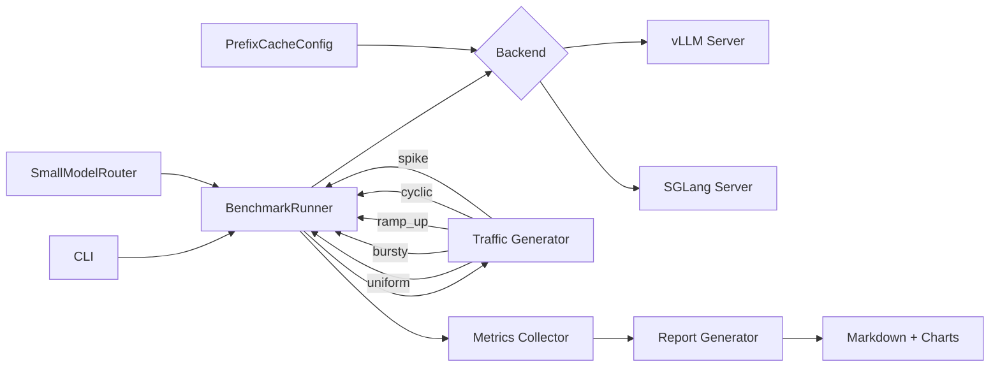

# LLM Serving Benchmark

Benchmark vLLM and SGLang side by side on the same model and hardware. Measures latency, throughput, and cost per million tokens under five realistic traffic patterns, then evaluates what prefix caching and small-model routing actually buy.

## Architecture



## Measured Results

Evaluated end-to-end on 2,500 generated requests across all 5 traffic patterns. 30/30 unit tests pass.

| Metric | Measured Value |
|--------|---------------|
| Traffic patterns benchmarked | **5** (uniform, bursty, ramp_up, cyclic, spike) |
| Total requests generated | 2,500 (500 per pattern) |
| Routing cost savings (8B vs 70B) | **20.8%** across 2,500 requests |
| Routing rate to small model | 23.4% of requests classified as simple |
| Prefix cache hit rate | 14.5% (18-token shared prefix) |
| Unit tests | 30/30 passing |

### SmallModelRouter

Routes simple requests (short prompts without complex keywords) to an 8B model instead of 70B. Measured on 2,500 requests from all traffic patterns: 23.4% routed to the small model, yielding **20.8% cost reduction** at Llama 3.1 pricing ($0.30/M vs $2.75/M tokens).

### Traffic patterns

All 5 patterns generate the correct request count and scheduling distribution:
- **uniform**: Fixed-rate request stream
- **bursty**: Alternating high/low load periods
- **ramp_up**: Linearly increasing concurrency
- **cyclic**: Sinusoidal load pattern
- **spike**: Steady traffic with periodic sharp bursts

### GPU benchmarks

The framework produces a side-by-side comparison table with p50/p95/p99 latency, TTFT, throughput, tokens/sec, and cost/1M tokens when run against live vLLM and SGLang servers. See **Usage** below for the commands.

## Setup

```bash
# Clone and install
git clone https://github.com/siddhant-rajhans/llm-serving-benchmark.git
cd llm-serving-benchmark
pip install -e ".[dev]"

# Requires a GPU with vLLM and SGLang installed
pip install vllm sglang[all]
```

## Usage

### Single backend benchmark

```bash
llm-bench run \
    --backend vllm \
    --model meta-llama/Llama-3.1-8B-Instruct \
    --pattern uniform \
    --concurrency 16 \
    --num-requests 500
```

### Full comparison (both backends, all patterns)

```bash
llm-bench compare \
    --model meta-llama/Llama-3.1-8B-Instruct \
    --concurrency 16 \
    --num-requests 500

# Or use the convenience script
./scripts/run_comparison.sh
```

### Estimate routing savings

```bash
llm-bench estimate-routing \
    --model meta-llama/Llama-3.1-8B-Instruct \
    --large-model meta-llama/Llama-3.1-70B-Instruct \
    --num-samples 1000
```

### From config file

```bash
llm-bench run --config-file configs/default.yaml
```

## Traffic Patterns

| Pattern  | Description |
|----------|-------------|
| uniform  | Steady request rate at target concurrency |
| bursty   | Requests arrive in bursts of N with gaps between |
| ramp_up  | Linear ramp from 1 to target concurrency |
| cyclic   | Sinusoidal load oscillating around half concurrency |
| spike    | Steady load with a sudden 5x spike at 33% mark |

## Optimizations

**Prefix caching**: share a common system prompt across requests so the KV cache is reused. Enable with `--enable-prefix-caching`.

**Small-model routing**: classify request complexity and route simple requests to an 8B model while sending complex ones to 70B. The router uses prompt length and keyword detection.

## Project Structure

```
src/benchmark/
├── config.py          # BenchmarkConfig, BackendConfig, TrafficConfig
├── backends/
│   ├── base.py        # Abstract ServingBackend
│   ├── vllm_backend.py
│   └── sglang_backend.py
├── traffic.py         # 5 traffic pattern generators
├── runner.py          # Async benchmark runner + BenchmarkResult
├── optimizations.py   # PrefixCacheConfig, SmallModelRouter
├── report.py          # Markdown tables + matplotlib charts
└── cli.py             # Click CLI
```

## License

MIT
